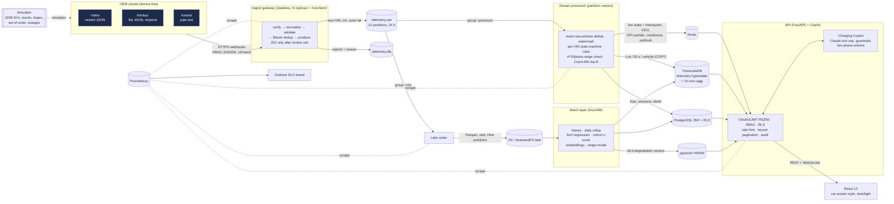
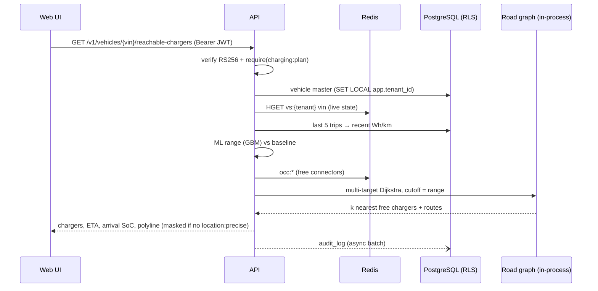
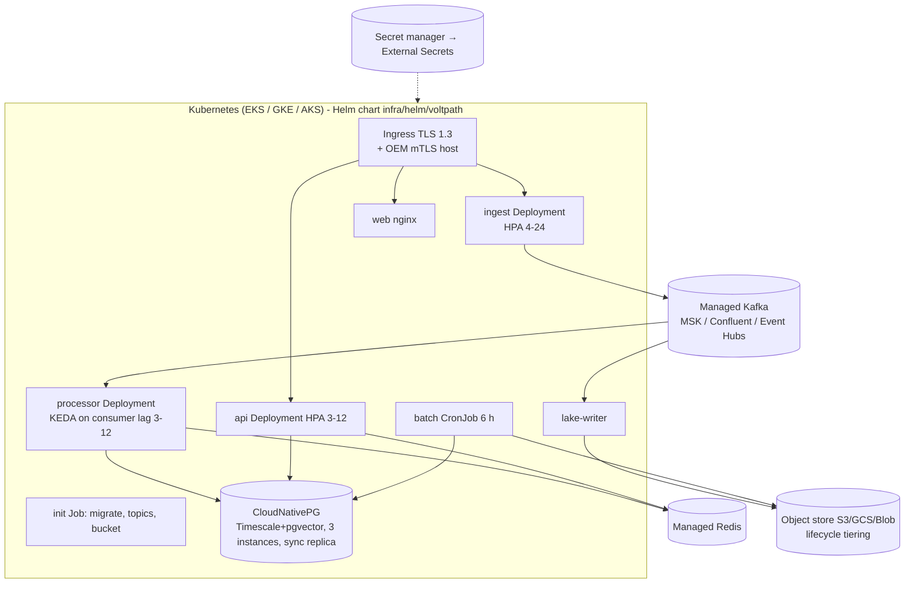

# VoltPath architecture

## System context and data flow

## Request path: "Can this vehicle reach a charger?"

## Deployment (Kubernetes, any cloud)

- **Stateless:** ingest, api and web scale horizontally on CPU through the HPA.
- **Processors** scale on Kafka lag through KEDA, capped at 12 by the partition count.
- **No single point of failure:**
  - Kafka RF=3 with `min.insync.replicas=2`
  - Redis primary plus replica with automatic failover
  - Postgres with 3 CNPG instances and a synchronous replica
  - PodDisruptionBudgets, and pods spread across AZs
- **Recovery** was demonstrated locally by `make chaos` (broker and processor SIGKILL, zero loss).

## Hot / warm / cold data lifecycle

| Tier | Store | Resolution | Retention | Monthly cost at 100K vehicles (AWS list prices, estimate) |
|---|---|---|---|---|
| Hot | Redis | latest state per vehicle, 2 s KPIs | live | ~$250 (r7g.large ×2) |
| Warm | TimescaleDB (compressed after 1 d) | 1 pt / 30 s / vehicle + 15-min cagg | 30 d | ~$1,100 (3× r7g.2xlarge + 1.5 TB gp3) |
| Cold | Parquet on S3 (zstd, ~90 B/event) | full 1 Hz fidelity | 3 y (IA after 30 d, Glacier IR after 90 d) | grows ~$0.6K/month each month; ~$6.5K at steady state |
| History | `battery_daily` hypertable + Parquet | daily per vehicle | 3 y | negligible |

Raw volume at 1 Hz is 8.6B events/day, about 0.8 TB/day as Parquet (vs 8.6 TB/day raw JSON). The warm tier keeps 1/30 of the samples and compresses about 10–20×.

## Consistency choices (CAP / PACELC)

| Data | Choice | Why |
|---|---|---|
| Billing, subscriptions, schedules, audit, RBAC | **CP**, PC/EC (sync replica, serializable where needed) | Money and compliance: a stale or lost write is unacceptable. We accept a small write-latency cost. |
| Charging sessions and trips | CP, written idempotently from the stream | Derived from events and replayable, but billing-relevant |
| Live vehicle state, KPIs, map clusters | **AP**, PA/EL | A second of staleness is fine. Availability and latency matter more; it can be rebuilt from Kafka. |
| Raw telemetry (log, lake) | AP at the edge (OEM retries) + durable log (RF=3) | Ingestion must never block. Order matters only per vehicle, which the VIN key guarantees. |
| Alerts | At-least-once + cooldown dedup | A duplicate alert is annoying. A missed critical alert is worse. |
