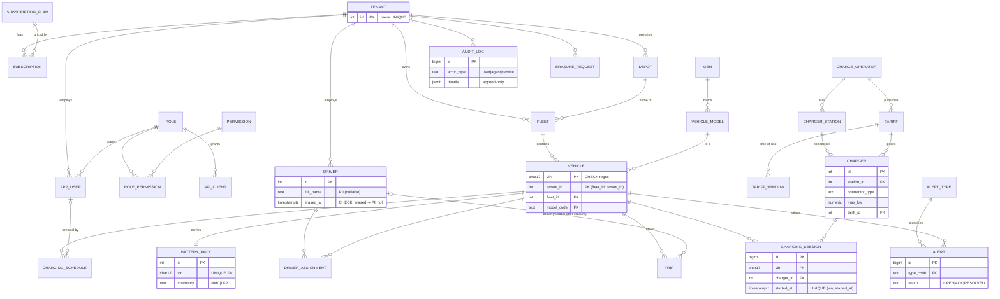

# Relational model (3NF)

Source of truth: `db/migrations/001_core.sql` … `006_query_tuning.sql`.

Time-series and analytics tables live outside the 3NF core: `telemetry` (hypertable), `telemetry_15m` (continuous aggregate), `battery_daily` (hypertable), `soh_forecast`, `fleet_energy_daily`, and `battery_embedding`/`kb_chunk` (pgvector).

## Normalisation notes
- **1NF.** Every column is atomic. DTC lists live in telemetry events and the lake, not in the relational core. Tariff time windows are rows (`tariff_window`), not arrays.
- **2NF.** All composite keys (`role_permission`, `driver_assignment (vin, from_ts)`) have no partial dependencies.
- **3NF.** Model attributes (capacity, rated range, OEM) sit in `vehicle_model`, not on `vehicle`. Operator names sit in `charge_operator`. Alert severity comes from `alert_type`. Prices come from the tariff through the charger, not from the session. Sessions store the realised `cost` as a historical fact, because tariffs change later.

## Deliberate denormalisations (documented, constraint-protected)
| Where | Why | How anomalies are prevented |
|---|---|---|
| `vehicle.tenant_id` (derivable via `fleet`) | RLS predicate and the hottest queries avoid a join | Composite FK `(fleet_id, tenant_id) → fleet(id, tenant_id)` makes a mismatch impossible |
| `tenant_id` on `trip`, `charging_session`, `alert`, `telemetry`, `battery_daily`, `soh_forecast` | RLS on each table without joins. Hypertables need the column for tenant-scoped views. | Written only by the processor and batch from the authoritative `vehicle.tenant_id` |
| `charger_station.geohash6` | Cheap spatial bucketing without PostGIS | Derived in the seed from lat/lon; never updated independently |
| `charging_session.cost`, `energy_kwh` | Historical invoice fact (tariffs change) | Immutable after insert |
